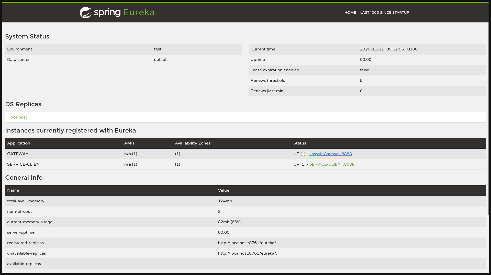
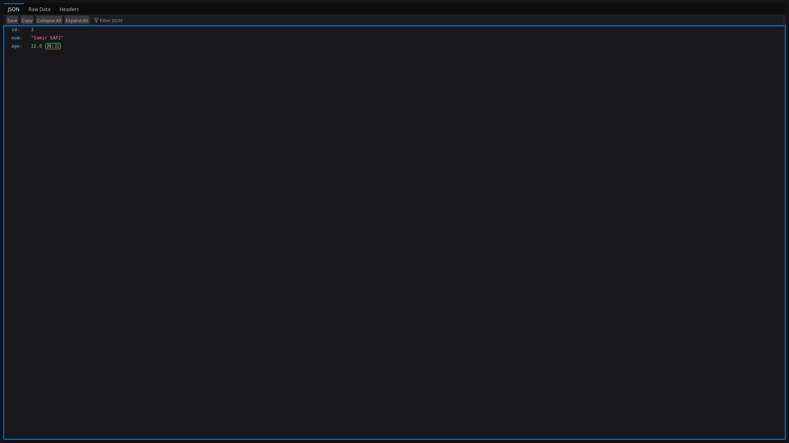
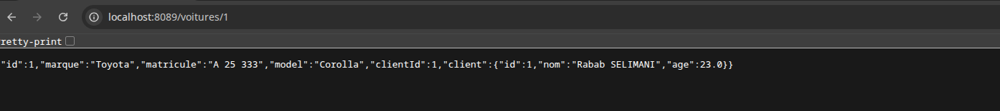
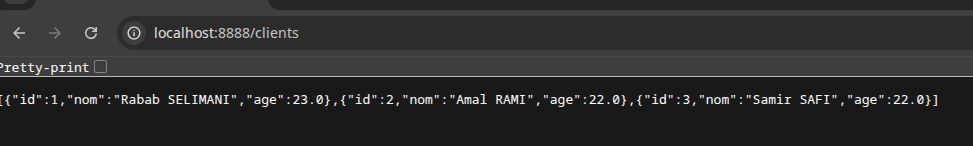
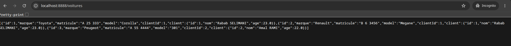

# TP 19 — Eureka, Gateway et OpenFeign

## 1. Lancement

Avec Java 17, démarrer Eureka, Client, Voiture puis Gateway.
Attendre que `SERVICE-CLIENT` soit visible dans Eureka avant de lancer Voiture.

## 2. Vérifications

Le tableau de bord affiche les applications enregistrées et leur état.

La requête sur le port 8088 renvoie les informations de Samir SAFI.

La requête sur le port 8089 renvoie la Toyota. Voiture utilise OpenFeign
pour récupérer le nom et l’âge de son propriétaire auprès du service Client.

## 3. Tests de la Gateway

Les deux captures ci-dessous montrent les routes testées avant
le passage à la configuration dynamique automatique.

Dans la version finale, Gateway crée les routes à partir des services
enregistrés dans Eureka. Les URL à tester sont les suivantes.

- `http://localhost:8888/SERVICE-CLIENT/clients`
- `http://localhost:8888/SERVICE-VOITURE/voitures`
